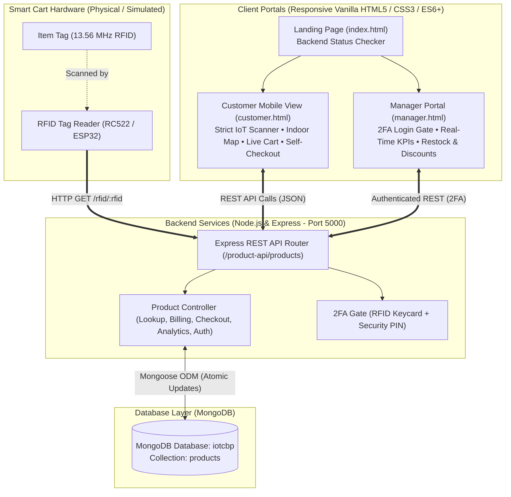

# 🛒 Smart Cart System (`iotcbp`)
### Automated RFID-Based Supermarket Retail, Indoor Navigation & Inventory Management
*IoT Course Based Project (CBP) • Academic Prototype & Full-Stack System*

---

## 📌 Executive Summary

Traditional supermarket shopping models suffer from long physical checkout queues, inefficient item discovery across large store floors, manual billing errors, and delayed inventory updates.

The **Smart Cart System (`iotcbp`)** is an end-to-end Internet of Things (IoT) prototype that eliminates billing lines and automates retail operations:
1. **IoT Cart Scanning**: Shoppers place physical items tagged with RFID chips into a smart cart equipped with an RFID antenna. The cart automatically identifies products, enforces authentic sensor-based cart entry, and tracks item quantities.
2. **Interactive Indoor Navigation**: An interactive indoor store blueprint maps all catalog products to their physical shelves (Aisles A, B, C; Shelves A1–C2), providing an illuminated walking path from the Entrance to the target shelf and onwards to Self-Checkout.
3. **Automatic Real-Time Billing & Discounts**: Dynamic subtotal, promotional item discounts (e.g. 5%–25% off), GST calculations, and grand total recalculate instantaneously upon each scan.
4. **Self-Checkout & Atomic Inventory**: Instant payment confirmation issues a digital tax invoice while atomically deducting physical stock and incrementing sales in MongoDB.
5. **Store Manager Console with 2-Factor Authentication (2FA)**: Store managers access restricted operational analytics through a 2-factor hardware gate (Staff RFID Keycard + 4-digit PIN), viewing real-time KPIs, fast-moving items, low-stock restock alerts, and live promotional discount management.

---

## 🏛️ System Architecture



---

## 🛠️ Technology Stack

| Layer | Component | Description & Key Libraries |
| :--- | :--- | :--- |
| **Backend Runtime** | Node.js (v18+) | JavaScript ES Modules (`type: module`), asynchronous event-driven server |
| **Web Framework** | Express.js (v5.x) | REST API endpoints, static file serving, 404/500 middleware |
| **Database** | MongoDB (v6.x / v7.x) | Local database `mongodb://127.0.0.1:27017/iotcbp` |
| **Object Modeling** | Mongoose (v9.x) | Schema validation, unique constraints, atomic operations (`$inc`, `$gte`) |
| **Middleware & Security**| CORS, Dotenv | Cross-origin resource sharing, environment variables configuration |
| **Frontend UI** | Vanilla HTML5 & CSS3 | Responsive CSS Grid, Flexbox, touch-friendly mobile layout, zero external framework overhead |
| **Client Scripting** | Vanilla JavaScript (ES6+) | Native `fetch` API, DOM manipulation, `sessionStorage` 2FA session manager |

---

## 📡 REST API Reference

All routes are mounted under the base path `/product-api/products`:

| Method | Endpoint | Description | Request Payload / Params | Success Response |
| :--- | :--- | :--- | :--- | :--- |
| `GET` | `/` | Fetch all supermarket catalog products | None | `{ success: true, count: 8, products: [...] }` |
| `GET` | `/rfid/:rfid` | Hardware RFID scan lookup | URL Param: `:rfid` (e.g., `RFID001`) | `{ success: true, product: { name, price, stock, discount... } }` |
| `GET` | `/:id` | Lookup product by `productId` or `_id` | URL Param: `:id` (e.g., `P001`) | `{ success: true, product: {...} }` |
| `POST` | `/checkout` | Atomic self-checkout: deducts stock & records sales | Body: `{ items: [{ productId, quantity }] }` | `{ success: true, orderId: "ORD-...", updatedProducts: [...] }` |
| `POST` | `/manager/auth` | Manager 2-Factor Authentication gate | Body: `{ rfid: "RFID-ADMIN", pin: "1234" }` | `{ success: true, token: "...", manager: {...} }` |
| `GET` | `/manager/analytics` | Real-time sales revenue, KPIs & restock alerts | None | `{ success: true, analytics: { totalRevenue, topSelling... } }` |
| `PUT` | `/:id/discount` | Update promotional discount percentage | URL Param: `:id`, Body: `{ discount: 15 }` | `{ success: true, message: "...", product: {...} }` |
| `PUT` | `/:id/restock` | Replenish inventory stock in MongoDB | URL Param: `:id`, Body: `{ amount: 10 }` | `{ success: true, message: "...", product: {...} }` |

---

## 🔌 IoT Hardware Integration Guide (Future Scope Blueprint)

This prototype includes a fully defined hardware abstraction layer designed to transition seamlessly from simulated software scanning to physical IoT hardware.

```
 +-------------------------------------------------------+
 |                     SMART CART                        |
 |                                                       |
 |   [ ESP32 Wi-Fi MCU ] <--- SPI ---> [ MFRC522 RFID ]  |
 |          |                                            |
 |     Wi-Fi Network                                     |
 |          v                                            |
 |   [ Express Server http://192.168.1.100:5000 ]        |
 +-------------------------------------------------------+
```

### 1. Hardware Bill of Materials (BOM)
- **Microcontroller**: ESP32 DevKit V1 (with onboard 2.4 GHz 802.11 b/g/n Wi-Fi & Bluetooth).
- **RFID Reader**: MFRC522 (13.56 MHz RFID Reader/Writer).
- **RFID Tags**: ISO 14443A MIFARE Classic 1K adhesive tags or key fobs.
- **Power Supply**: 5V/2A rechargeable Lithium-Ion battery pack with 3.3V voltage regulation.

### 2. Wiring Pinout Table

| MFRC522 Pin | ESP32 GPIO Pin | Function |
| :--- | :--- | :--- |
| **VCC** | `3.3V (3V3)` | Power supply (Note: Do NOT connect to 5V!) |
| **RST** | `GPIO 22` | Reset signal |
| **GND** | `GND` | Ground reference |
| **MISO** | `GPIO 19` | SPI Master In / Slave Out |
| **MOSI** | `GPIO 23` | SPI Master Out / Slave In |
| **SCK** | `GPIO 18` | SPI Clock |
| **SDA (SS)** | `GPIO 5` | SPI Chip Select |

### 3. Production ESP32 Sketch & Tag Configuration Utility
- Full production sketch located at: [`hardware/smartcart_rfid/smartcart_rfid.ino`](hardware/smartcart_rfid/smartcart_rfid.ino).
- Physical tag mapping script: [`backend/update_physical_tags.js`](backend/update_physical_tags.js) (run via `npm run update-tags`).

```cpp
#include <WiFi.h>
#include <HTTPClient.h>
#include <SPI.h>
#include <MFRC522.h>

#define SS_PIN  21
#define RST_PIN 22

const char* ssid = "Supermarket_WiFi";
const char* password = "StoreSecretPassword";
const char* serverUrl = "http://192.168.1.100:5000/product-api/products/rfid/";

MFRC522 rfid(SS_PIN, RST_PIN);

void setup() {
  Serial.begin(115200);
  SPI.begin();
  rfid.PCD_Init();

  WiFi.begin(ssid, password);
  while (WiFi.status() != WL_CONNECTED) {
    delay(500);
    Serial.print(".");
  }
  Serial.println("\nWiFi Connected! Cart IoT Antenna Active.");
}

void loop() {
  // Check if a new RFID card is presented
  if (!rfid.PICC_IsNewCardPresent() || !rfid.PICC_ReadCardSerial()) {
    return;
  }

  // Convert Tag UID bytes to Hex String
  String tagId = "";
  for (byte i = 0; i < rfid.uid.size; i++) {
    tagId += (rfid.uid.uidByte[i] < 0x10 ? "0" : "");
    tagId += String(rfid.uid.uidByte[i], HEX);
  }
  tagId.toUpperCase();
  Serial.println("Item Scanned: " + tagId);

  // Send HTTP GET request to Smart Cart Backend
  if (WiFi.status() == WL_CONNECTED) {
    HTTPClient http;
    String requestUrl = String(serverUrl) + tagId;
    http.begin(requestUrl);
    int httpCode = http.GET();

    if (httpCode == 200) {
      String response = http.getString();
      Serial.println("Product Added to Basket: " + response);
    } else {
      Serial.printf("Lookup error. HTTP Code: %d\n", httpCode);
    }
    http.end();
  }

  rfid.PICC_HaltA();
  rfid.PCD_StopCrypto1();
  delay(1500); // Debounce to prevent accidental double-reads
}
```

---

## 🚀 Future Scope & Enhancements

1. **Mechanical Cart Enclosure**:
   - 3D-printed enclosure mounted on the cart handle housing an integrated 7-inch touch display, ESP32 board, and recessed RFID reader coil.
2. **Camera Computer Vision & Weight Sensor Verification**:
   - High-precision load cells beneath the cart basket coupled with an overhead camera to match physical added weight against the scanned RFID item weight, preventing shrinkage and barcode tampering.
3. **UPI & Payment Gateway Integration**:
   - Direct QR-code generation (Razorpay / UPI Intent) on the cart screen allowing one-touch mobile payments before cart unlocking.
4. **Cloud Migration & Microservices**:
   - Containerized deployment with Docker and Google Cloud Run / AWS ECS, connecting to MongoDB Atlas with multi-store replication.

---

## 📋 Step-by-Step Viva Presentation Script (5-Minute Walkthrough)

Follow this exact walkthrough during project demonstration to showcase all key features:

### Step 1: Launch & System Health Verification (30 Seconds)
- Open `http://localhost:5000/index.html`.
- **Evaluator Talking Point:**
  > *"Here is the central portal. Notice the live green status indicator confirming that our Express backend and MongoDB database `iotcbp` are fully online. We have two dedicated user portals: Customer View and Store Manager View."*

### Step 2: Indoor Supermarket Route Map (1 Minute)
- Click **"Open Customer View"** (`customer.html`).
- Scroll to the **Supermarket Indoor Route Map**.
- Click the quick locate button `📍 Milk (A1)` or type `Milk` in the search bar.
- **Evaluator Talking Point:**
  > *"Customers can search for any product to immediately see its exact aisle and shelf location. Notice the route animation highlighting the step-by-step path: Store Entrance ➔ Central Corridor ➔ Shelf A1 ➔ Checkout Counters. Shelf inventory badges dynamically update based on MongoDB stock."*

### Step 3: Strict IoT RFID Scanning & Automatic Billing (1 Minute)
- Scroll up to the **Smart Cart Reader**.
- Type `RFID001` (Milk) and click **"Scan Item"**.
  - *Observe:* Milk is added to the cart; subtotal updates to ₹50.00.
- Type `RFID001` again and click **"Scan Item"**.
  - *Observe:* System increments quantity to 2; subtotal becomes ₹100.00.
- Type `RFID005` (Biscuits - 10% OFF offer).
  - *Observe:* Real-time billing applies the 10% discount (`- ₹3.00`), showing original price struck through, effective price, and net grand total.
- **Evaluator Talking Point:**
  > *"This enforces real IoT cart sensor logic: items can only enter the cart via authentic RFID reads. As items are placed in the cart, unit prices, promotional discounts, taxes, and grand totals compute in real-time."*

### Step 4: Interactive UPI QR Code Payment & Digital Tax Invoice (45 Seconds)
- Click **"Proceed to Self-Checkout"**.
  - *Observe:* The **UPI Payment Modal** opens with a dynamic Indian NPCI UPI QR code (encoded for GPay, PhonePe, Paytm, BHIM) displaying the exact net payable amount and discount savings.
- Highlight the **Store VPA (`smartcart@upi`)** and test clicking **"Return to Cart"** (cancels without affecting stock).
- Re-open and click **"✓ Confirm & Complete Payment"**.
  - *Observe:* The transaction completes atomically; stock is decremented in MongoDB, and the official **Digital Tax Invoice & Receipt Modal** appears with a unique Order ID and timestamp.
- **Evaluator Talking Point:**
  > *"Before issuing the digital tax receipt, the system presents an interactive NPCI UPI QR code dynamically encoded with the exact bill amount, compatible with Google Pay, PhonePe, and Paytm. Confirming payment updates physical inventory atomically in MongoDB."*

### Step 5: Manager 2-Factor Authentication (2FA) Gate (45 Seconds)
- Click the top navigation link **"🔒 Manager"** (`manager.html`).
- Click **"⚡ Fill Admin Credentials"** (`RFID-ADMIN` and `1234`) and click **"Unlock Manager Dashboard"**.
- **Evaluator Talking Point:**
  > *"Administrative controls are protected behind 2-Factor Hardware Authentication requiring both an authorized Manager RFID Staff Keycard (Factor 1) and a secure PIN (Factor 2)."*

### Step 6: Live Analytics, Restock & Dynamic Discounts (1 Minute)
- Review the **KPI Metric Cards**: Total Products, Total Items Sold, and Total Sales Revenue.
- Under **Live Inventory Controls**, find `Milk`:
  - Click **`[ + Restock ]`**, select `+10 Units`, and confirm.
    - *Observe:* Stock updates instantly in MongoDB without page reload.
  - Click **`[ 🏷️ Discount ]`**, select `20% OFF`, review the live preview calculator, and save.
    - *Observe:* Milk's discount is persisted to MongoDB. Subsequent customer scans immediately apply the 20% discount.
- Click **"🔒 Lock / Logout"** to securely lock the console.
- **Evaluator Talking Point:**
  > *"The manager console provides real-time visibility into supermarket performance, stock replenishment, and promotional pricing that synchronizes instantaneously across all shopping carts."*

---

## 🏃 How to Run the Project Locally

### 1. Prerequisites
- [Node.js](https://nodejs.org/) (v18.0.0 or higher)
- [MongoDB Community Server](https://www.mongodb.com/try/download/community) running locally on port `27017`

### 2. Environment Configuration
Verify `backend/.env`:
```env
PORT=5000
MONGO_URI=mongodb://127.0.0.1:27017/iotcbp
MANAGER_RFID=RFID-ADMIN
MANAGER_PIN=1234
```

### 3. Install Dependencies
```bash
# In the project root directory
npm --prefix backend install
```

### 4. Seed the Database
```bash
# In the project root directory
npm run seed
```

### 5. Start the Server
```bash
# In the project root directory
npm start
```
Open your browser and navigate to: **`http://localhost:5000`**
